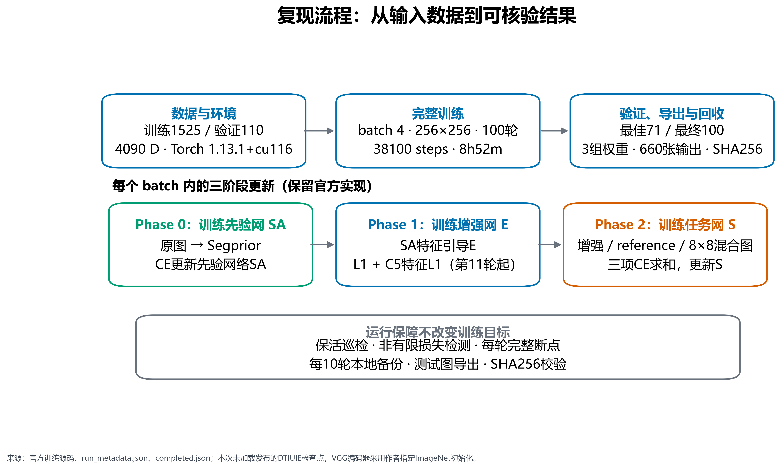
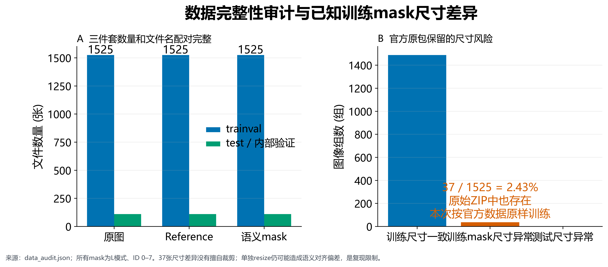
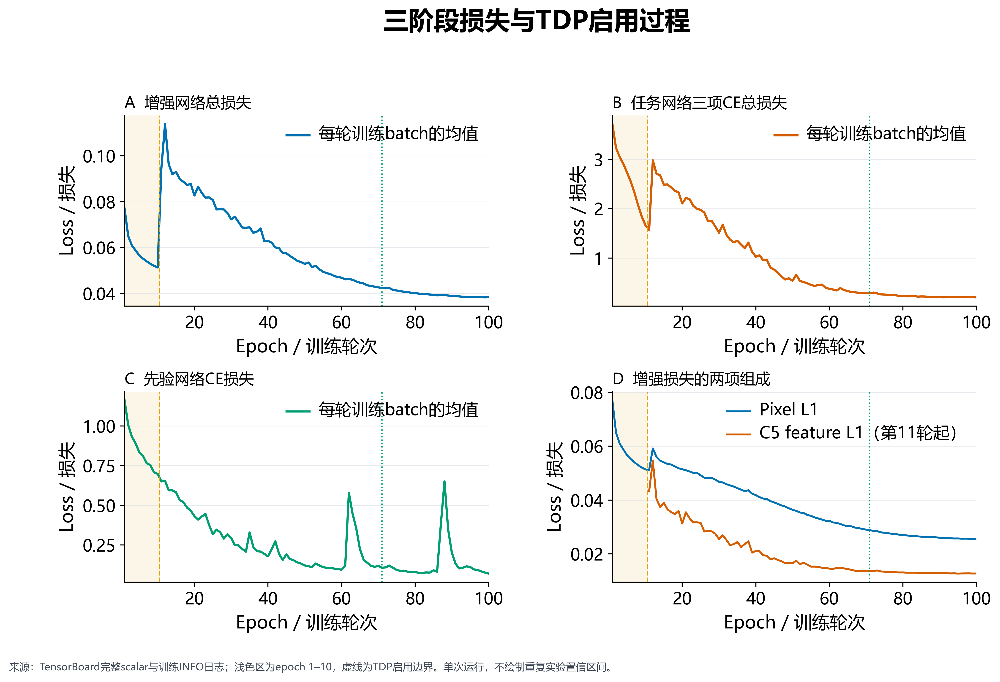
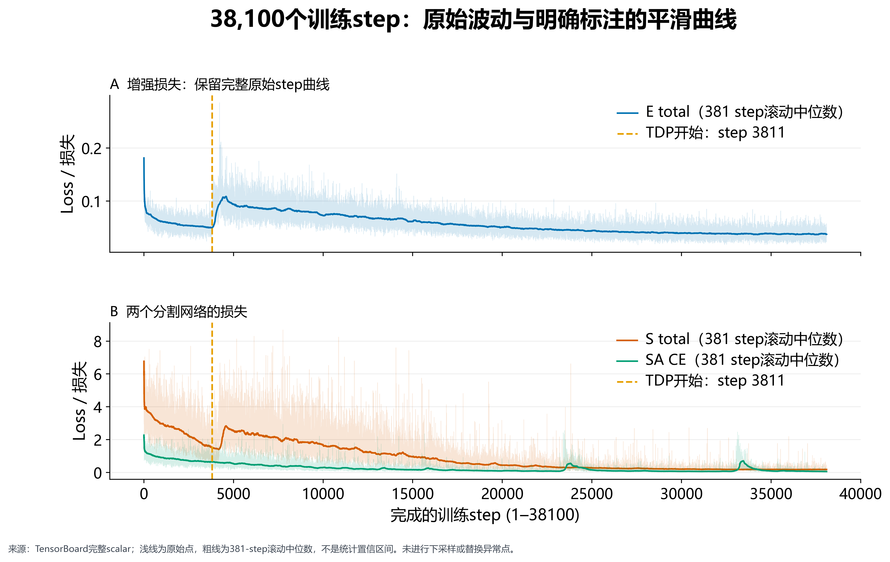
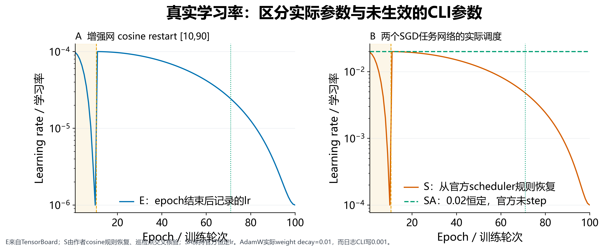
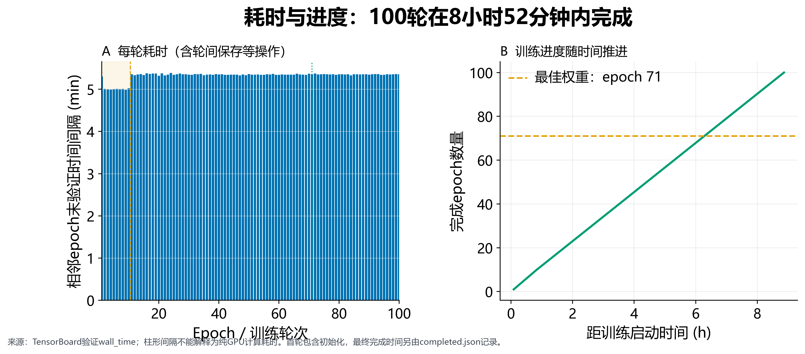
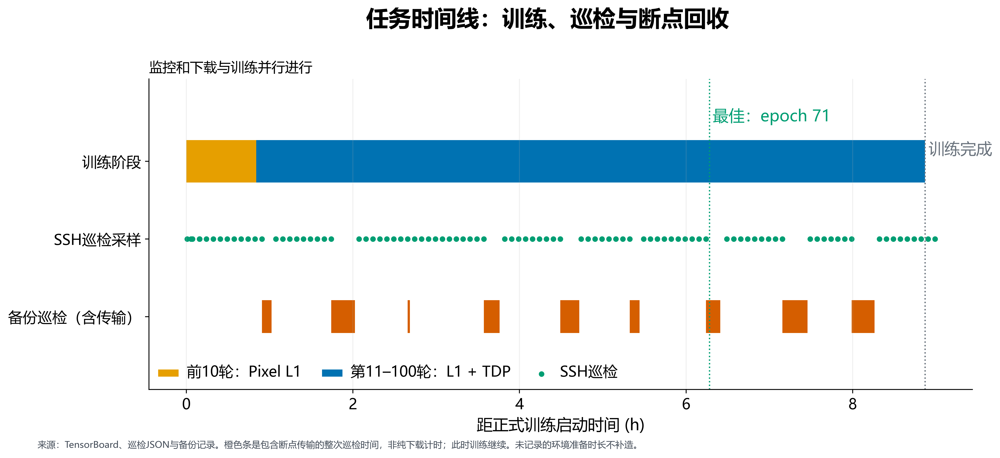
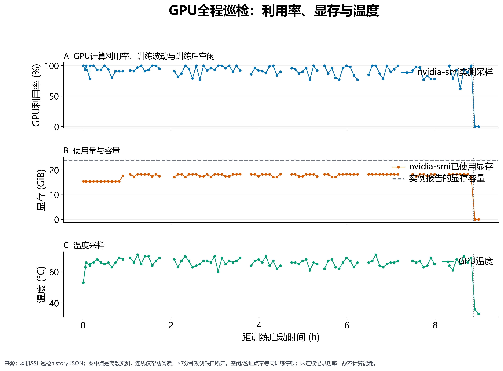
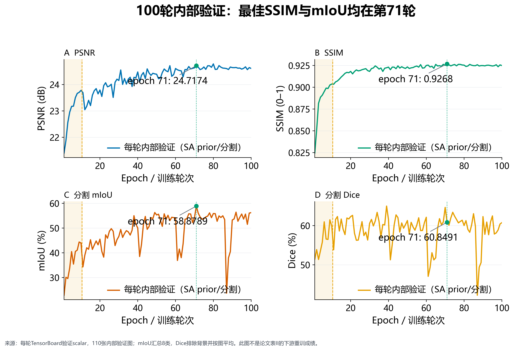
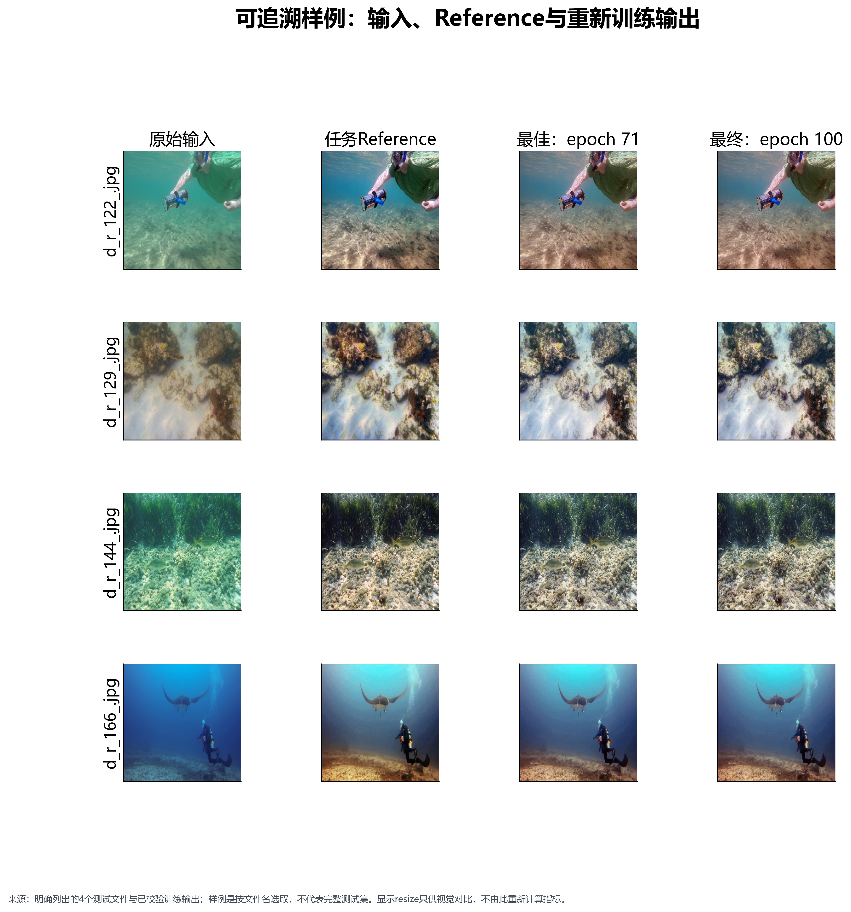

# DTIUIE 从头训练复现：过程、结果与可核验证据

本次完成了官方 DTIUIE 代码默认配置下的 **100 轮从头训练、38,100 个训练批次更新**，并回收权重、完整断点、日志和测试输出。实际运行使用 AutoDL 的 RTX 4090 D，2026 年 10 月 3 日北京时间 11:53:32 开始，20:45:46 完成，耗时 **8 小时 52 分钟 14 秒**。独立监督程序记录重启 0 次；已保存的巡检记录没有报告异常。本文的曲线和数值来自这一次真实运行，未增加重复实验或补造观测数据。

目标论文为 *Downstream Task-Inspired Underwater Image Enhancement: A Perception-Aware Study From Dataset Construction to Network Design*，代码来源为 [oucailab/DTIUIE](https://github.com/oucailab/DTIUIE)。用户最终指定的执行规则是“**官方代码优先，代码没有说明的再参考论文**”。因此，完成的是官方实现的增强网络训练与内部验证；论文表 II 的独立下游网络重训仍需另做实验。

## 1. 做了什么，如何界定完成

初期根据“已有权重、跑一遍”的要求，将工作理解为预训练检查点推理，完成了环境核对和两种引导网络的小样本验证。用户随后明确要求重新训练，任务即调整为从头执行完整 100 轮。前期推理只作为部署检查，未被计入本次训练结果；正式训练没有加载发布的 epoch 28 DTIUIE 权重。增强网络 E 随机初始化，两个任务编码器则按官方代码使用 ImageNet VGG16-BN 初始化。

**图 1 的读法：**沿箭头依次查看数据审计、三网络训练、内部验证、断点和图像回收。这里的“从头训练”允许作者指定的骨干初始化，不能误解为三个网络所有参数都随机初始化。完成证据包括 `completed.json` 的 epoch=100、global_step=38100，以及实际存在且已核验的最终完整断点。

对导师而言，验收可从三个问题开始：第一，是否确实重新学习了增强网络，而非重复加载发布权重；第二，是否完整执行预定更新次数，而非只展示一张训练截图；第三，是否能够追溯报告中每一条曲线的原始来源。本次分别用初始化配置、连续 step 及轮末记录、源日志哈希来回答。原始训练源码和运维副本各有独立哈希，数据重建又保留来源索引，能区分算法执行、运行保护和事后绘图三个环节。

“完成训练”与“复现论文所有实验”是两个不同验收条件。前者由本次训练和导出记录满足；后者需要追加论文中不同数据集、不同下游网络和评价协议。本文将完成的工作具体化，既呈现训练投入，也保留尚未进行的实验清单，便于决定下一步研究工作。

## 2. 数据、环境和实际生效的配置

TI-UIED 的 trainval 包含 1,525 组三联数据：原图、reference、分割 mask；test 包含 110 组。文件名配对完整，全部图像可解码，mask 为 L 模式、类别 ID 0–7。训练 batch=4、`drop_last=True`，故每轮为 381 个 batch，即当轮使用 1,524 个样本；100×381=38,100。110 张 test 被官方训练入口用于逐轮内部验证，不是另外留出的最终未见测试集。

**图 8 的读法：**先看三目录数量是否一致，再看训练 mask 的尺寸差异。37 张异常在官方 ZIP 内同样存在，不是上传损坏；本次按官方数据原样保留。官方分别 resize 并不能保证原始尺寸不一致的图像与 mask 语义完全对齐，这一风险必须随结果报告。

| 项目 | 本次实际运行值 |
|---|---|
| GPU / 显存 / 驱动 | RTX 4090 D / 24,564 MiB / 595.71.05 |
| Python / PyTorch / torchvision | 3.9.16 / 1.13.1+cu116 / 0.14.1+cu116 |
| CUDA runtime / 关键依赖 | 11.6；NumPy 1.23.5、Pillow 9.4.0、timm 0.9.7、einops 0.6.1 |
| 数据与训练长度 | TIUIED，256×256，batch=4，100 epochs，warmup=10 |
| E 优化器 | AdamW，lr=1e-4，betas=(0.9,0.999)，实际 weight_decay=0.01 |
| S / SA 优化器 | SGD，lr=0.02，momentum=0.9，weight_decay=1e-4 |
| 学习率 | E/S cosine restart，周期 [10,90]；SA 保留恒定 0.02 |
| 损失与混合 | 像素 L1，TDP 特征 L1；8×8 sigmoid 随机混合掩码，nearest 放大 |
| 数值和性能设置 | 单卡 float32；无 autocast；cuDNN benchmark；CPU 线程及 DataLoader workers=8 |

上述配置以真实优化器状态和执行代码为准。例如 CLI 打印的 weight_decay=0.001 并未传给 E 的 AdamW，实际使用默认 0.01；三项 S 交叉熵的 CLI 权重 0.34 也未生效，代码直接求和。SA 调度器的绑定及未调用行为按官方实现保留。`seed=2022` 参数存在，但设置随机种子的调用被注释，不能声称本次已固定种子或能逐位复现。

## 3. 深度学习训练如何进行

每个 batch 有三个相继执行的更新子阶段：先用原图和 mask 更新 SA；再取 SA 的特征作为 prior，更新增强网络 E；最后将增强图 detach，让 S 分别学习增强图、reference 和二者的混合图，三项交叉熵相加。这里的三阶段指每次迭代的更新顺序，而不是三次独立训练。

第 1–10 轮 E 只使用像素 L1；第 11 轮起增加 S 的 C5 特征 L1，即 TDP。第 11 轮边界对应完成 step 3,810 之后，TensorBoard 首个特征损失 step=3810（零基），即第 3,811 次训练更新（一基）。因此，warmup 前后 E 的目标函数不同，不能把损失边界的变化简单解释为训练变差。

可以将三个网络理解为相互协作的角色：E 负责输出增强图，SA 负责从原图产生增强所需的引导特征，S 负责学习任务相关的分割表征并在 warmup 后提供特征监督。它们各自有优化器，因此三个损失的数值尺度不同，不能直接将它们加成一个没有定义的排行榜。S 阶段对增强图使用 detach，将此阶段的更新对象限制到对应网络；本次保留官方前向、梯度和训练/验证模式切换，没有为了显存或速度改变这种协作方式。

参考图约束增强图的像素关系，任务特征约束两者在网络表征中的关系；二者变化一起看，才容易判断不同训练阶段正在优化什么。数据集提供的 reference 是本实验的参考目标，不能仅凭其名称把它解释为水下场景绝对真实的物理颜色。视觉对比、像素分数与下游任务分数因此互为补充，而不是可以相互替代。

**图 2 的读法：**分别观察 E、S、SA 和像素/特征项，浅色区域为 warmup。E 的轮均值由第 1 轮 0.076984 变为第 100 轮 0.038424；S 从 3.713039 变为 0.203130，SA 从 1.160385 变为 0.070287。E 第 100 轮由像素项约 0.025668 和特征项约 0.012756 组成；这比一个没有定义的“总 loss”更能解释学习过程。

**图 10 的读法：**浅线保留 38,100 个原始 step 值，粗线为明确标注的 381-step 滚动中位数。平滑只是方便看趋势，不是重复实验的置信区间，也没有替换尖峰。特征损失只有后 90 轮，共 34,290 个真实值；前 10 轮的缺失没有填成伪造的测量。

**图 4 的读法：**E 的记录值是每轮 scheduler.step 之后的 TensorBoard 值，下一轮才使用它；第 1 轮实际使用 1e-4。S 曲线按官方调度公式重建并与巡检优化器状态交叉核对，不能称为逐轮原始实测。SA 恒定学习率来自代码行为及采样状态。图中重启边界有算法依据，不是人为调参。

## 4. 如何回溯日志并证明训练连续完成

数据重建脚本只读结果归档和巡检 JSON，不连接云端、不读取凭据、不改原日志。它完整读取 TensorBoard event 中 **302,090 条 scalar**，按 tag/step 对齐，形成 100 轮表和 38,100-step 表；验证 step 连续、无重复及非有限数值，并检验 E=像素+特征、S=三项交叉熵和轮平均关系。

终端 tqdm 会在同一 batch 输出进度更新和 postfix，原日志有 76,200 条相应记录。按 `(epoch,batch)` 保留最后一条，得到 38,100 条，而不是将重复刷新误算为双倍训练。终端损失有舍入，数值绘图优先使用 TensorBoard 完整精度，终端作为独立交叉检查。来源文件、大小、SHA256 和 CSV 字段口径保存于 [provenance.json](../data/provenance.json)，检查结果见 [reconstruction_checks.json](../data/reconstruction_checks.json)。

便携材料中另附105个哈希核验的原始来源副本，见 [证据映射](../evidence/source_map.json)。因此可以从图表、CSV一路追溯到原始step标量和巡检记录，而不只依赖本文描述；不重复复制大权重，也不包含密码或私钥。

时间字段也作了来源区分：TensorBoard 的 wall_time 用于轮边界和步数轨迹，巡检 JSON 的 checked_at_utc 用于 GPU 快照。巡检文件名更接近整次检查完成时间，遇到大文件下载会比采样时间晚，因此没有拿文件名替代 GPU 测量时刻。原始时间保存为 UTC，额外提供北京时间列，避免把时区转换后的日期差误认为训练跨天或暂停。

完整断点与普通推理权重承担不同用途。最佳权重用于选模型和出图；完整断点还需要优化器动量、调度器阶段、缩放器及随机状态，才能接续下一轮。本次结果包保留两者，报告目录则只链接大文件，避免重新复制数 GB 资产。这样，展示用图表可以轻量分享，训练恢复仍有可核验的原始依据。

**图 6 的读法：**轮耗时由相邻验证结束时间推得，包含轮边界保存开销，不能当作纯 GPU kernel 时间。全部轮均值约 319.23 秒；warmup 轮均约 302.17 秒，启用 TDP 后约 321.12 秒。首轮包含初始化。结束时间由独立完成记录校验，不为满足“约十小时”而提前停训或增加轮数。

**图 7 的读法：**训练进度、GPU 巡检与断点回收是并行活动。每轮原子保存完整断点，10、20、…、90 轮共有 9 次本机备份；最后从结果包回收第 100 轮。橙色时间段表示含传输的整次巡检耗时，不能当作纯下载时间，更不能当作训练停顿。环境准备没有完整时间序列，未补画虚构时长。

## 5. 整个GPU的实际情况

**图 5 的读法：**94 条快照中 92 条为训练状态、2 条在完成后。训练状态样本的 GPU 利用率均值 **91.73%**、中位数 93%、范围 62–100%；显存范围 **15,732–18,734 MiB**，温度范围 **53–71°C**。这些是离散样本的未加权统计，不能解释为连续九小时的时间加权占用率。验证、保存和采样瞬间也可能改变利用率。

名义巡检间隔约五分钟，存在 **8 个超过七分钟的观测缺口，最长约二十分钟**。大断点下载会阻塞顺序巡检，缺口内没有瞬时 GPU 测量；图中将这些位置断开，未插值。94 次保存的 SSH 检查均成功，不能由此推断每秒连接都被记录。未保存 GPU 功率，故本报告没有功率曲线或耗电量估算。

训练持续性主要由完整 step、100 轮验证记录、监督程序与断点证明，GPU 快照用于呈现资源状态。二者用途不同，应一起查看。

资源图还帮助解释为什么不能只按增强网络自身估算机器需求：训练同时使用两个任务网络，warmup 后增加任务特征前向与相关梯度路径，显存和轮耗时会随阶段变化。观察到显存升高时，应先对照第十一轮边界、验证与保存状态，再考虑是否存在泄漏。采样峰值仍低于本卡总显存，但它不是每一瞬间的分配峰值；不能据此直接断言更小显存显卡也能完成同一配置。本次选择保持作者的 batch 与精度，以预检确认容量，再通过自动选核和后台运行提高稳定性。

## 6. 得到了哪些结果，怎样理解

**图 3 的读法：**每轮均在同一 110 张内部验证图上使用 `model_SA`；最佳 SSIM 和 mIoU 同时出现于第 71 轮。第 100 轮并非所有指标最佳，保留最佳检查点有实际意义。以下为单次运行结果，不提供重复实验的置信区间。

| 检查点与评测协议 | epoch | PSNR / dB | SSIM | mIoU | Dice |
|---|---:|---:|---:|---:|---:|
| 最佳 SSIM / mIoU，逐轮 `model_SA` | 71 | 24.717359 | 0.926810 | 0.588789 | 0.608491 |
| 第 100 轮，逐轮 `model_SA` | 100 | 24.612019 | 0.924937 | 0.562245 | 0.607655 |
| 原作者末尾 `model_S` 评测 | 100 | 24.5528* | 0.9247* | 0.514840 | 0.540215 |

星号表示末尾日志只打印四位小数；未补造更多精度。最后一行切换了分割网络和 prior 来源，不能直接用与第二行的差值证明“最后一次训练突然退化”。原分割评估的 mIoU 汇总八类，Dice 排除背景并按图平均，也应与外部实验的指标定义逐项对齐。

**图 9 的读法：**按明确文件名展示四张输入、reference、第 71 轮和第 100 轮输出，帮助观察颜色和结构变化；样例不是整个测试集结论。显示 resize 仅为版面统一，未据此重新计算指标。三组检查点各导出 110 张 JPEG 与 PNG，总计 660 张，均有 `run_manifest.json` 记录 SHA256、引导网络、尺寸和完成数量。

原代码的 pixAcc 在 softmax 后先转 long 再 argmax，概率被截断，指标无效；UIQM/UCIQE 未真正累计，日志中的 0 是占位。训练总 loss 和 Train PSNR 也有未更新 meter 的占位 0，本报告排除这些字段。论文全文没有报告本次内部 PSNR/SSIM，表 II 需增强数据上的独立下游重训，表 V 需 SUIM-E/UIEB 及其图像质量协议，均不能直接拿本表替代。

最佳两份权重都落在第七十一轮，这说明两种保存准则在本次轨迹上选择了同一轮模型，不是又做了两次训练。第七十一轮相对第一轮的内部验证提升可以描述为这一次优化轨迹的结果；由于未重复多个随机种子，不能进一步宣称改进幅度的统计显著性。后期轻微波动也需要结合目标函数、验证集选模和评测网络理解，不能只根据一条平滑曲线归因。

训练产物已从云端下载，归档 SHA256 与来源一致，三组图像可在本机解码并核对尺寸、模式与数量。读取 manifest 还能明确每组输出使用哪份权重和引导网络。由“文件存在”到“数量正确、可以读取、协议有记录”的这组检查，比单纯看到最后一行训练日志更能支撑交接。

## 7. 最难的问题和必须保留的注意事项

最费工作的环节是把旧代码、云端网络和长时间训练的可恢复性串起来，而不是只让一次前向成功。部署记录中的 PyTorch wheel 下载经 r2 源超时后转向 SJTU，采用范围分块、响应范围校验和 SHA256 检查；依赖安装等待时并行上传已准备的代码、权重和训练数据。SSH 公钥认证未成功后使用用户授权的密码连接，凭据以本机当前用户 DPAPI 加密保存。

旧 Torch 受限加载器遇完整检查点浮点字段，会报 `Unsupported operand 71`（BINFLOAT）。只对经过 SHA256 确认的官方文件或本次可信检查点使用完整读取，不能为所有未知文件随意关闭限制。正式训练前分别执行 warmup 与启用 TDP 的真实 batch=4 预检，后者显存要求更高；仅测第一阶段不足以保证后九十轮可以跑完。

原作者 `--resume` 并不能完整恢复三模型训练。因此保留原源码，生成独立运维副本，补齐三模型、三优化器、调度器、scaler、随机状态和完成步数的原子断点。剥除运维插入后 AST 与原训练逻辑一致；小模型恢复测试验证下一次更新与不中断参考一致。本次实际没有重启，这不能变成“已经发生过云端恢复”的表述。

用户选择代码优先后，L1、nearest、SA 调度行为、实际权重衰减与论文/文字说明之间的差异均记录保留，没有为了曲线漂亮修改数学逻辑。37 张 mask 尺寸风险、未固定随机种子、重复使用内部验证集选最佳模型，都是后续论文对表和多次试验前应处理或明确声明的问题。

## 8. 可视化工具与交付方式

本报告十组主图由可重跑的 Python 脚本生成 PNG、SVG、PDF。MATLAB **R2025b Update 5** 已实际以隐藏 batch 模式运行并导出三组 PNG、矢量 PDF 与可编辑 FIG；FIG 已重新打开，确认存在 100 轮或 94 点的数据对象，另保存 MAT 数据和调用日志，见 [MATLAB 产物](../tools/matlab/)。

Origin 的隔离 COM 调用实际失败，旧注册指向不存在的可执行文件；仅交付 CSV、调用证据和内置 Python 重建脚本，**没有 OPJU 或 Origin 渲染图**，见 [Origin 专项说明](../tools/origin/README.md)。本机 TeX Live 2025 的 XeLaTeX 已实际双遍编译，退出码为 0，交付 [报告 PDF](../DTIUIE_复现报告.pdf) 与独立保存的源文件、编译日志及构建记录。完整重画、继续训练、可信权重推理和下一步论文对表方法见 [复现交接文档](复现交接文档.md)。
